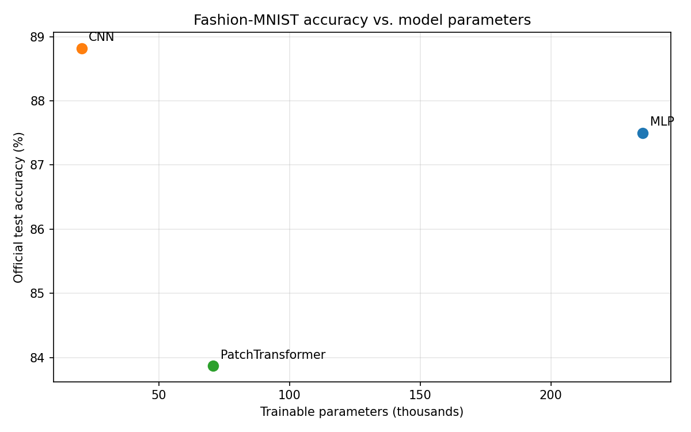
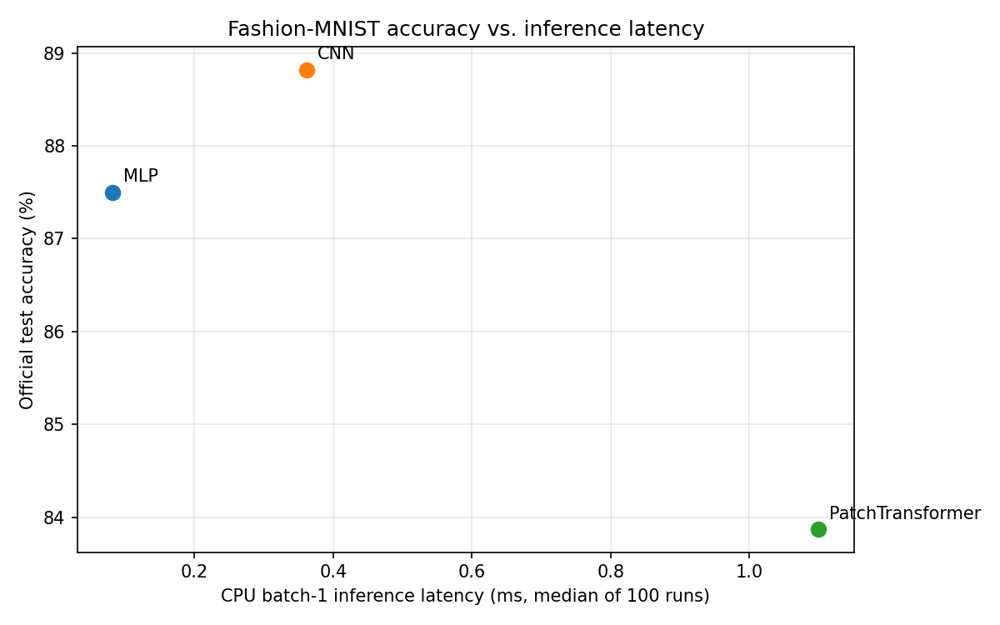

# Lab 3: Fashion-MNIST dataset

`src/dataset.py` loads Fashion-MNIST using `torchvision.datasets.FashionMNIST`.
Images are converted with `ToTensor()` and normalized with mean `(0.2860,)`
and standard deviation `(0.3530,)`.

The official 60,000-image training set is split reproducibly into 55,000
training images and 5,000 validation images using seed 42. The official
10,000-image test set remains separate. The data loaders use batches of 128,
shuffling only the training data.

Run `python src/dataset.py` from the `Lab03` directory to download the dataset
if needed and print the resulting split sizes.

## Classification models

`src/models.py` defines the three specified Fashion-MNIST classifiers:

- **MLP:** flatten 784 pixels, then fully connected layers 256 and 128 with
  ReLU, followed by a 10-class output layer.
- **CNN:** 1-to-16 and 16-to-32 padded 3x3 convolutions, each followed by ReLU
  and 2x2 max pooling, then a 10-class linear layer.
- **PatchTransformer:** split each image into sixteen non-overlapping 7x7
  patches, project each patch to 64 features, apply two Transformer encoder
  layers (`d_model=64`, `nhead=4`, `dim_feedforward=128`), mean-pool the patch
  features, and classify with a 10-class linear layer.

The architecture specifications result in different parameter counts rather
than a common 100k–150k range: approximately 235,146 for the MLP, 20,490 for
the CNN, and 70,794 for the PatchTransformer. Run `python src/models.py` from
the `Lab03` directory to print each exact count and verify the `(2, 10)` output
shape on a two-image input batch.

## Compute cost and inference latency

Run `python src/cost_analysis.py` from `Lab03` to produce
[`results/cost_analysis.csv`](./results/cost_analysis.csv) and the full
[`results/torchinfo_summaries.txt`](./results/torchinfo_summaries.txt).
`torchinfo.summary` supplies the parameter counts. Latencies are CPU
`torch.inference_mode()` medians after 10 warm-up calls: 100 timed runs at
batch size 1 and 20 at batch size 128. The timing uses random tensors of the
same `(batch, 1, 28, 28)` shape, so it excludes dataset loading and
preprocessing.

| Model | Parameters (`torchinfo`) | Hand FLOPs/image | THOP parameters | THOP FLOPs/image* | THOP below hand | Batch 1 (ms) | Batch 128 (ms) |
|---|---:|---:|---:|---:|---:|---:|---:|
| MLP | 235,146 | 469,504 | 235,146 | 469,504 | 0.00% | 0.181900 | 0.783500 |
| CNN | 20,490 | 2,063,488 | 20,490 | 2,063,488 | 0.00% | 0.472100 | 12.047000 |
| PatchTransformer | 70,794 | 2,329,856 | 3,850 | 101,632 | 95.64% | 1.008950 | 8.298450 |

The hand counts use two FLOPs per multiply-accumulate and count matrix and
convolution multiply-adds, excluding biases and elementwise operations. For
example, the first MLP linear layer costs
`2 × 784 × 256 = 401,408` FLOPs. The first CNN convolution costs
`2 × 3 × 3 × 1 × 16 × 28 × 28 = 225,792` FLOPs. In each Transformer encoder
layer, QKV projections cost `2 × 16 × 64 × 3 × 64 = 393,216` FLOPs and the
attention score and weighted-value products cost
`2 × 16² × 64 = 32,768` FLOPs each. Including the attention output projection
and both feed-forward linear layers, one encoder layer totals 1,114,112
FLOPs. The full Transformer total also includes both encoder layers, the
patch projection, and classifier.

*THOP reports MACs; the table converts them to estimated FLOPs by multiplying
by two. It agrees with these hand counts for the MLP and CNN. Its Transformer
profile counts only the patch projection and classifier (50,816 MACs), missing
the encoder's functional multi-head attention and feed-forward work; similarly,
its 3,850 parameter count omits the encoder parameters. Use the `torchinfo`
total of 70,794 for the Transformer parameter count. These operation counts
also omit softmax, LayerNorm, residual additions, ReLU, pooling, patch
rearrangement, and mean pooling, so they are estimates rather than a count of
every primitive operation.

Latency is specific to this CPU and PyTorch environment; larger batches take
longer overall, but throughput cannot be inferred from per-batch latency
alone.

## Five-epoch training and accuracy-cost comparison

Run `python src/train_models.py` from `Lab03` to train all three models on the
55,000-image training split for five epochs with Adam (`lr=0.001`, batch size
128), then evaluate once on the official 10,000-image test set. Training runs
on CUDA when available and otherwise on CPU. Inference latency is measured on
CPU for comparison with the compute-cost experiment, after training, using
10 warm-up calls followed by 100 runs at batch size 1 and 20 runs at batch
size 128. Results are saved in
[`results/training_results.csv`](./results/training_results.csv).

| Model | Parameters | Test accuracy | CPU batch 1 median (ms) | CPU batch 128 median (ms) |
|---|---:|---:|---:|---:|
| MLP | 235,146 | 87.50% | 0.080700 | 0.529400 |
| CNN | 20,490 | 88.82% | 0.479650 | 12.746800 |
| PatchTransformer | 70,794 | 83.87% | 0.935000 | 7.029550 |

Accuracy plotted against parameter count:

Accuracy plotted against single-image CPU inference latency:

The CNN is the most parameter-efficient choice here: it has the fewest
parameters and the highest test accuracy, exceeding the MLP by 1.32 percentage
points with about one eleventh of its parameter count. It is not the fastest
for single-image inference, however; the MLP is about six times faster at
batch size 1, trading additional parameters for lower measured latency. Thus
the CNN is the stronger choice when model size and accuracy dominate, while
the MLP is preferable when this CPU's batch-1 latency is the priority. The
PatchTransformer is dominated in this run: it has more parameters and lower
accuracy than the CNN, and its batch-1 latency is the highest.

This reflects the different access patterns discussed in Chapters 4.6–4.7.
The MLP performs dense, regular matrix operations over a flattened image;
its larger weight matrices can use efficient dense linear algebra, and the
small batch-1 workload has little per-image overhead. The CNN uses local
spatial windows and reuses each small convolution kernel across many image
locations. That sharing makes its parameter count very small and its local
image access pattern exploits spatial reuse, although the repeated convolution
work over feature maps and pooling/intermediate-map traffic can cost more
latency on this CPU, especially at batch size 128. The Transformer first
rearranges pixels into patches, then projects and mixes patch sequences. Its
attention creates intermediate Q/K/V and attention data and performs
sequence-wide interactions, adding data movement and compute that are not
fully reflected by THOP's incomplete Transformer profile. With only 16
patches, this model did not translate that extra machinery into better
accuracy or latency in the five-epoch run. These results are specific to the
hardware, software, and training budget; alternate accelerators or longer
training may change the trade-offs.